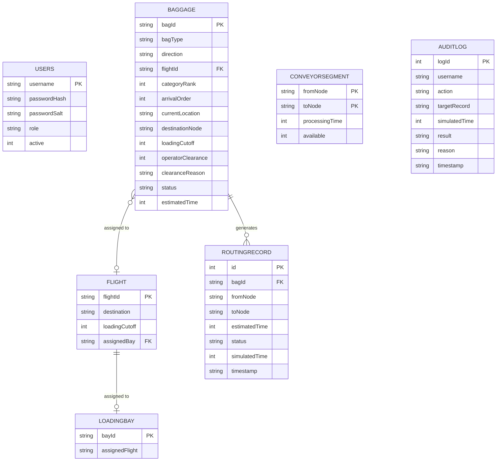

# Vaanam Airport Intelligent Baggage Handling and Routing System
**Second Project Review (Review 2) Deliverable**

An intelligent, compact, and deterministic airport baggage management system for Vaanam Airport. Built with a pure Java backend, persistent SQLite database, and a responsive browser-based frontend using HTML, CSS, and vanilla JavaScript.

---

## 1. Problem Statement and Objectives

### Existing Problems in Manual Baggage Handling
1. **Mishandled & Lost Luggage:** Manual routing and dispatch lead to misdirected bags, missed connecting flights, and baggage delays.
2. **Flight Cutoff Violations:** Without real-time path estimation, bags arriving after departure cutoffs are mistakenly loaded or cause costly aircraft turn-around delays.
3. **Conveyor Bottlenecks & Hardware Failures:** Mechanical conveyor jams or maintenance shutdowns stop manual workflows because staff lack automated alternate-route calculation.
4. **Lack of Role Segregation:** Check-in staff, baggage handlers, and security screeners often share ad-hoc terminal access without cryptographic authentication or an immutable audit log.
5. **One-Way Bias:** Traditional academic prototypes only model outbound check-in, completely ignoring inbound passenger arrivals (aircraft-to-carousel) and transit transfer handling.

### Proposed Solution & Project Objectives
- **Strict File Limit:** Exactly 5 core Java source files for clear architecture and student viva explainability, plus a standalone test suite.
- **Two-Way Baggage Operations:** Full support for Outgoing (Check-in → Bay), Incoming (Unload Point → Claim Carousel), and Transfer (Transit Hub → Connecting Bay) workflows.
- **Deterministic Prioritization:** Custom Java `PriorityQueue` sorting bags by flight cutoff, transfer urgency, passenger class (First > Business > Economy), arrival order, and bag ID tie-breaker.
- **Dynamic Dijkstra Routing:** Directed weighted conveyor graph finding minimum-time transit paths, recalculating dynamically when segments fail.
- **Strict Cutoff Validation:** Prevents loading bags onto aircraft if transit time exceeds the departure loading cutoff.
- **Role-Based Security:** 5 distinct operational roles (`ADMIN`, `SUPERVISOR`, `BAGGAGE_OPERATOR`, `SECURITY_OFFICER`, `AUDITOR`) enforced server-side with PBKDF2 password hashing and session tokens.
- **Visual Browser Interface:** Real-time dashboard with connected-node route representation, live ETA, and failure simulation.

---

## 2. System Architecture & Java File Structure

The project has been refactored and consolidated to meet the **strict 5-file backend limit**:

```
Mini-Project-I/
├── src/
│   ├── Main.java             # Server entry point, HTTP routing, session & API handlers
│   ├── Models.java           # Consolidated domain models, enums & data structures
│   ├── DatabaseManager.java  # SQLite persistence, schema migrations, audit logging
│   ├── BaggageService.java   # Priority queue, Dijkstra routing, two-way tracking, simulated clock
│   ├── Auth.java             # PBKDF2 hashing (10,000 iterations), role permission enforcement
│   └── TestRunner.java       # Standalone automated test suite (21 evaluation test suites)
├── web/
│   ├── index.html            # Dashboard structure, modals, route visualization
│   ├── style.css             # Consistent navy-and-light operations design system
│   └── app.js                # Vanilla JavaScript state management and REST calls
├── lib/
│   └── sqlite-jdbc.jar       # Pure Java SQLite JDBC driver
├── data/
│   └── airport.db            # Persistent SQLite database
└── README.md                 # Project documentation and review report
```

### Detailed File Responsibilities

| File | Lines | Key Components & Responsibilities |
|---|---|---|
| [`src/Main.java`](file:///c:/Users/yuthg/Mini-Project-I/src/Main.java) | ~880 | Initializes database, default accounts, and embedded `com.sun.net.httpserver.HttpServer` on port 8080. Implements REST endpoints for auth, baggage, flights, conveyors, security clearance, and audit logs. Serves static frontend files. |
| [`src/Models.java`](file:///c:/Users/yuthg/Mini-Project-I/src/Models.java) | ~250 | Defines `Baggage`, `OriginBag`, `TransferBag`, `IncomingBag`, `Flight`, `LoadingBay`, `ConveyorSegment`, `DijkstraNode`, `RoutingResult`, `User`, `Role`, `PassengerCategory`, `BaggageDirection`, and `BaggageStatus`. |
| [`src/DatabaseManager.java`](file:///c:/Users/yuthg/Mini-Project-I/src/DatabaseManager.java) | ~510 | SQLite JDBC connectivity, schema initialization, table migrations (`Baggage`, `Flight`, `LoadingBay`, `ConveyorSegment`, `RoutingRecord`, `Users`, `AuditLog`), prepared statements, and query execution. |
| [`src/BaggageService.java`](file:///c:/Users/yuthg/Mini-Project-I/src/BaggageService.java) | ~670 | Core business logic: PriorityQueue with deterministic comparator, `ConveyorRoutePlanner` using Dijkstra's algorithm, conveyor toggle & failure rerouting, cutoff validation, and simulated clock. |
| [`src/Auth.java`](file:///c:/Users/yuthg/Mini-Project-I/src/Auth.java) | ~120 | Cryptographic PBKDF2 with HmacSHA256 (16-byte random salt, 10,000 iterations), session token mapping, and server-side role validation (`requireUserPermission`). |
| [`src/TestRunner.java`](file:///c:/Users/yuthg/Mini-Project-I/src/TestRunner.java) | ~400 | Automated verification runner testing 21 distinct evaluation criteria across all operational features. |

---

## 3. Database Schema and Persistence

SQLite stores all state persistently in [`data/airport.db`](file:///c:/Users/yuthg/Mini-Project-I/data/airport.db). Restarting the application preserves all user records, bag statuses, flights, and audit trails without duplication.

### Entity Relationship & Tables



---

## 4. Authentication & Five-Role Permission Matrix

Every state-changing API request performs strict Java backend validation using server-managed sessions. Roles cannot be forged or bypassed from browser JavaScript.

| Role | Permitted Actions | Strictly Prohibited Actions |
|---|---|---|
| **ADMIN** | Provision accounts, change roles, activate/deactivate accounts, reset passwords, update flights/bays, toggle conveyors, view all records & audit log. | **Cannot bypass or grant security clearance** (must be performed by certified Security Officer). |
| **SUPERVISOR** | View baggage/flights/conveyors, update flight departure cutoffs, reassign loading bays, simulate conveyor failure (toggle offline/online), advance simulated clock. | Cannot manage user accounts; cannot grant security clearance. |
| **BAGGAGE_OPERATOR** | Register baggage, assign flights, view priority queues, process queued baggage into conveyors. | Cannot grant security clearance; cannot override cutoff validation; cannot edit users or toggle conveyors. |
| **SECURITY_OFFICER** | Inspect baggage awaiting clearance, approve screening, reject screening with mandatory reason, view clearance decisions. | Cannot manage staff accounts; cannot reconfigure flights or conveyors; cannot process bags into loading bays. |
| **AUDITOR** | Read-only access to baggage records, flight schedules, conveyor statuses, routing history, and immutable audit logs. | **Cannot create or modify any record** (any mutation attempt throws `SecurityException`). |

### Default Staff Accounts for Demonstration

| Username | Password | Role |
|---|---|---|
| `admin` | `admin123` | `ADMIN` |
| `supervisor` | `super123` | `SUPERVISOR` |
| `operator` | `op123` | `BAGGAGE_OPERATOR` |
| `security` | `sec123` | `SECURITY_OFFICER` |
| `auditor` | `audit123` | `AUDITOR` |

---

## 5. Two-Way Baggage Operations (Workflows)

As specifically recommended in mentor review records, the system handles two distinct operational directions and transfer connections:

```mermaid
graph TD
    subgraph Outgoing_Workflow ["Outgoing Baggage Workflow"]
        O1[Check-in Registration] --> O2[Security Screening Hub]
        O2 -- Approved --> O3[Queued in PriorityQueue]
        O2 -- Rejected --> OR[REJECTED: Halted]
        O3 --> O4[Dijkstra Conveyor Routing]
        O4 --> O5{Arrival <= Cutoff?}
        O5 -- Yes --> O6[LOADED at Flight Bay]
        O5 -- No --> O7[MISSED_CUTOFF: Not Loaded]
    end

    subgraph Incoming_Workflow ["Incoming Baggage Workflow"]
        I1[Aircraft Unload Point] --> I2[Priority Queue]
        I2 --> I3[Dijkstra Conveyor Routing]
        I3 --> I4[CLAIMED at Baggage Carousel]
    end

    subgraph Transfer_Workflow ["Transfer Baggage Workflow"]
        T1[Inbound Transfer Point] --> T2[Transit Security Check]
        T2 -- Approved --> T3[Priority Queue]
        T3 --> T4[Dijkstra Conveyor Routing]
        T4 --> T5{Arrival <= Connecting Cutoff?}
        T5 -- Yes --> T6[LOADED at Connecting Bay]
        T5 -- No --> T7[MISSED_CUTOFF]
    end
```



1. **Outgoing Baggage:**
   - Starts at `CHECK-IN`. Enters `WAITING_FOR_CLEARANCE`.
   - Security Officer grants clearance with reason → enters `QUEUED`.
   - Baggage Operator dispatches bag → Dijkstra calculates path to assigned flight bay (`BAY-A`, `BAY-B`, `BAY-C`, or `BAY-D`).
   - If `SimulatedTime + RouteTime <= LoadingCutoff`, status transitions to `LOADED`.
   - If `SimulatedTime + RouteTime > LoadingCutoff`, status is flagged `MISSED_CUTOFF` and baggage is halted from loading.

2. **Incoming Baggage:**
   - Starts at `UNLOAD-POINT`. Does not require outbound flight cutoff checks.
   - Routed automatically via core conveyor network to `CLAIM-CAROUSEL-1` (Domestic) or `CLAIM-CAROUSEL-2` (International).
   - Arrival status marked `CLAIMED`.

3. **Transfer Baggage:**
   - Originates at `TRANSFER-A`. Assigned to connecting departure flight.
   - Given higher priority over origin bags in queue processing.
   - Verified against connecting flight cutoff before loading.

---

## 6. Core Algorithms: Dijkstra & Deterministic Priority Queue

### Priority Queue Tie-Breaking Order
Java's `PriorityQueue<Baggage>` sorts pending bags using a deterministic multi-stage comparator:
1. **Departure Loading Cutoff:** Earlier cutoff flights are prioritized first.
2. **Transfer Urgency:** Transfer bags take precedence over standard origin bags.
3. **Passenger Category Rank:** `FIRST_CLASS` (Rank 1) > `BUSINESS` (Rank 2) > `ECONOMY` (Rank 3).
4. **Arrival Order:** Earlier arrival sequence processed first (FIFO for same class/flight).
5. **Bag ID:** Deterministic string comparison tie-breaker (`b1.getBagId().compareTo(b2.getBagId())`) guaranteeing 100% reproducible ordering.

### Dijkstra Minimum-Time Routing & Failure Rerouting
- **Graph Topology:** Directed weighted graph with 14 nodes and positive edge weights:
  - `CHECK-IN` → `SORTING` (4 min)
  - `SORTING` → `TRANSFER-A` (5 min), `SORTING` → `TRANSFER-B` (6 min), `SORTING` → `CENTRAL` (7 min)
  - `TRANSFER-A` → `CENTRAL` (4 min), `TRANSFER-B` → `CENTRAL` (3 min)
  - `CENTRAL` → `BAY-AREA` (5 min)
  - `BAY-AREA` → `BAY-A` (3 min), `BAY-B` (4 min), `BAY-C` (3 min), `BAY-D` (5 min)
  - `UNLOAD-POINT` → `CENTRAL` (5 min), `CENTRAL` → `CLAIM-AREA` (4 min)
  - `CLAIM-AREA` → `CLAIM-CAROUSEL-1` (3 min), `CLAIM-CAROUSEL-2` (4 min)
- **Normal Shortest Path (`CHECK-IN` → `BAY-A`):**
  `CHECK-IN` → `SORTING` (4) → `CENTRAL` (7) → `BAY-AREA` (5) → `BAY-A` (3) = **19 minutes**.
- **Failure Rerouting:** When `SORTING` → `CENTRAL` is marked offline, Dijkstra automatically reroutes via `TRANSFER-B` (6 + 3 = 9) or `TRANSFER-A` (5 + 4 = 9), recalculating the new transit time to **21 minutes**.
- **No Route Fallback:** If all links to a destination are disabled, the system assigns `NO_ROUTE_AVAILABLE` instead of displaying invalid or stale arrival times.

---

## 7. Setup, Compilation, and Execution Commands

### Prerequisites
- JDK 17 or later installed.
- SQLite JDBC driver located in `lib/sqlite-jdbc.jar` (already included in repository).

### 1. Compile the Complete Application
```powershell
javac -d bin -cp "lib/*" src/*.java
```

### 2. Run the Automated Test Suite (21 Test Suites)
```powershell
java -cp "bin;lib/*" TestRunner
```

### 3. Start the Vaanam Airport Backend Server
```powershell
java -cp "bin;lib/*" Main
```

### 4. Open the Web Application
Open your web browser and navigate to:
```
http://localhost:8080
```
Log in using `admin` / `admin123` or any of the role accounts.

---

## 8. Test Cases and Actual Verification Results

Executing `java -cp "bin;lib/*" TestRunner` runs all 21 test scenarios:

```
=======================================================
   VAANAM AIRPORT BAGGAGE SYSTEM - COMPREHENSIVE TEST   
=======================================================

[Test Suite 1] Login & Password Authentication
  [PASS] Admin user exists in database
  [PASS] Login succeeds with correct password
  [PASS] Login fails with incorrect password

[Test Suite 2] First Administrator Setup
  [PASS] Active admin count is properly recognized

[Test Suite 3] Inactive Accounts and Session Invalidation
  [PASS] Inactive account is marked inactive
  [PASS] Inactive user has no permissions
  [PASS] Session is valid after login
  [PASS] Session is invalidated after logout

[Test Suite 4] Duplicate Username and Baggage ID Rejection
  [PASS] Duplicate baggage ID is strictly rejected

[Test Suite 5] All Five Roles Permitted and Prohibited Actions
  [PASS] Admin has ADMIN permission
  [PASS] Supervisor has SUPERVISOR permission
  [PASS] Operator has BAGGAGE_OPERATOR permission
  [PASS] Security Officer has SECURITY_OFFICER permission
  [PASS] Auditor has AUDITOR permission
  [PASS] Operator does not have SECURITY_OFFICER permission
  [PASS] Auditor does not have ADMIN permission

[Test Suite 6] Unauthenticated Request Enforcement
  [PASS] Unauthenticated null user is denied access

[Test Suite 7] Operator Attempting Security Clearance
  [PASS] Baggage Operator cannot grant security clearance

[Test Suite 8] Auditor Attempting Modification
  [PASS] Auditor cannot register or modify baggage

[Test Suite 9] Dijkstra Shortest Path Calculation
  [PASS] Route calculated between CHECK-IN and BAY-A
  [PASS] Dijkstra finds shortest path (19 mins)
  [PASS] Route begins at CHECK-IN and ends at BAY-A

[Test Suite 10] Conveyor Failure and Dynamic Rerouting
  [PASS] Alternate route found when SORTING->CENTRAL is unavailable
  [PASS] Rerouted time is 21 mins via transfer hub
  [PASS] Original shortest route restored (19 mins)

[Test Suite 11] No Available Route Detection
  [PASS] Returns null when no path exists to destination

[Test Suite 12] Cutoff Checks Before, At, and After Cutoff
  [PASS] Bag arriving before cutoff is successfully LOADED
  [PASS] Bag arriving after cutoff is marked MISSED_CUTOFF and not loaded

[Test Suite 13] Flight Loading-Bay Changes and Route Updates
  [PASS] Flight F101 re-assigned to BAY-B

[Test Suite 14] Outgoing Baggage Workflow
  [PASS] New outgoing bag enters WAITING_FOR_CLEARANCE
  [PASS] Cleared bag enters QUEUED
  [PASS] Processed bag reaches status LOADED at bay

[Test Suite 15] Incoming Baggage Workflow (Two-Way Operations)
  [PASS] Baggage is identified as incoming
  [PASS] Incoming baggage starts at UNLOAD-POINT
  [PASS] Incoming baggage destination is claim carousel
  [PASS] Incoming bag delivered to claim carousel with status CLAIMED

[Test Suite 16] Transfer Baggage Workflow
  [PASS] Identified as transfer bag
  [PASS] Transfer bag originates at TRANSFER-A
  [PASS] Transfer bag successfully routed to connecting flight loading bay

[Test Suite 17] Estimated Arrival Time Calculation
  [PASS] Base estimated route time is 19 minutes
  [PASS] ETA dynamically increases after conveyor failure (21 mins)

[Test Suite 18] Database Persistence Across Restarts
  [PASS] Baggage persisted in SQLite and reloaded upon restart
  [PASS] Flight association correctly persisted

[Test Suite 19] Audit-Log Persistence
  [PASS] Audit log persisted in database and queryable

[Test Suite 20] Prevention of Duplicate Processing
  [PASS] Already LOADED baggage cannot be reassigned or reprocessed

[Test Suite 21] Security Clearance Rejection Enforcement
  [PASS] Rejected bag status set to REJECTED
  [PASS] Security-rejected bag cannot be processed into conveyors or loaded onto aircraft

=======================================================
FINAL TEST RESULTS: 47 Passed, 0 Failed.
=======================================================
```

---

## 9. Sustainability, Cost, Resource Efficiency & SDG Impact

This project is designed as an academic prototype modeling airport automation principles without enterprise software overhead.

### Real-World Relevance & Sustainable Development Goals (SDGs)
- **SDG 9: Industry, Innovation, and Infrastructure**
  - Automates baggage routing using Dijkstra's shortest path algorithm. Minimizes mechanical motor runtime across conveyor networks, extending mechanical lifespan and reducing unnecessary energy draw during low-traffic periods.
- **SDG 11: Sustainable Cities and Human Settlements**
  - Improves airport turnaround punctuality and terminal throughput, supporting reliable regional and international transportation infrastructure.
- **SDG 12: Responsible Consumption and Production**
  - Reduces paper manifest waste by centralizing baggage tracking into an electronic dashboard with persistent SQLite records. Mitigates the heavy carbon emissions and logistical waste associated with flying misdirected baggage on recovery flights.

### Cost & Resource Efficiency
- **Zero Cloud or Subscription Cost:** Runs locally on commodity hardware without cloud subscriptions, paid database licenses, or paid APIs.
- **Zero External Framework Overhead:** Implemented using standard Java SE libraries (`com.sun.net.httpserver`, `java.sql`, `javax.crypto`). Eliminates memory-heavy frameworks like Spring Boot, minimizing RAM footprint to under 100 MB.

---

## 10. Limitations & Future Scope

### Current Academic Prototype Limitations
1. **In-Memory Session Storage:** Active session IDs are mapped in a concurrent Java memory map; a server restart forces staff to re-authenticate (though all database entities, baggage, flights, and audit logs persist in SQLite).
2. **Coarse-Grained Conveyor Segments:** Conveyors are modeled as discrete node-to-node segments with integer minute weights, rather than continuous feet-per-second physical motor speeds.
3. **Single-Node Deployment:** Designed for local evaluation on a single workstation rather than distributed multi-server clusters.

### Future Scope
1. **IoT / RFID Scanner Integration:** Integrate physical RFID or barcode scanner hardware over serial/MQTT to register bag checkpoints automatically.
2. **Predictive Jam Detection:** Use statistical machine learning to forecast conveyor motor stress and predict belt failure before downtime occurs.
3. **Distributed Session Storage:** Migrate session maps to Redis or signed JWTs for multi-terminal airport deployments.
