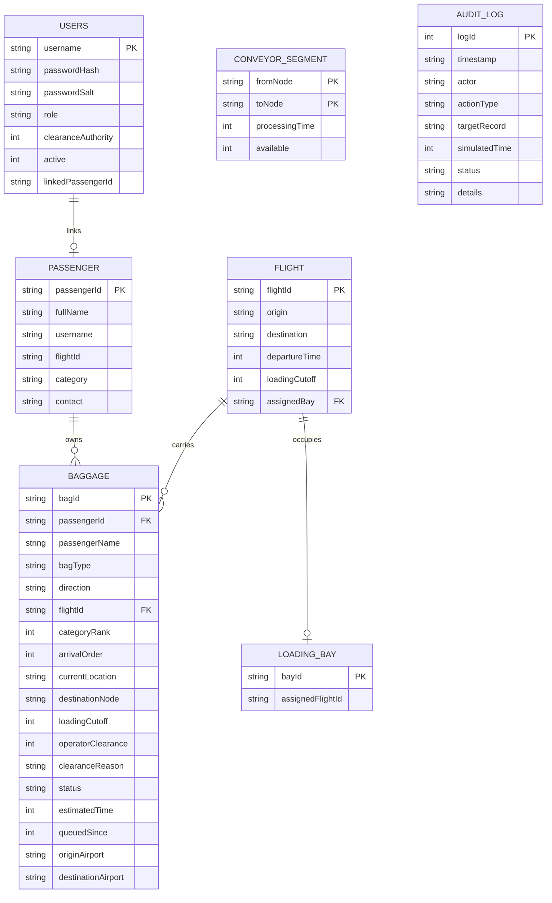

# Vaanam Airport Intelligent Baggage Handling and Routing System
**Second Project Review (Review 2) — College Mini-Project 10**

A compact, deterministic, and academically grounded airport baggage simulation for a fictional regional hub called **Vaanam Airport**. Implemented with a pure Java backend, persistent SQLite database via JDBC, and a student-built web interface using HTML, CSS, and Vanilla JavaScript. Baggage urgency is ranked with a small hand-written fuzzy inference system, and frequently read records can optionally be served through a Redis cache-aside layer without SQLite ever losing its role as the source of truth.

---

## 1. Problem Statement & Domain Context

Manual baggage processing in regional airports causes serious operational bottlenecks:

1. **Out-of-Order Waiting**: Bags for an imminent flight often wait behind bags for flights departing hours later because check-in queues do not prioritize by departure deadline.
2. **Missed Onward Loading Windows**: Transfer and connecting baggage from arriving flights frequently miss tight connecting departure windows.
3. **Conveyor Hardware Jams**: A mechanical breakdown along a critical conveyor belt interrupts planned routing, causing baggage piles without automated alternate-path recalculation.
4. **Flight Gate & Bay Reassignments**: Gate changes or loading bay switches leave baggage moving toward obsolete positions unless routes dynamically update.
5. **Security Clearance Violations**: Baggage without verified operator clearance must never enter conveyor dispatch to an aircraft.
6. **Cutoff Violations**: Bags whose remaining transit time exceeds the flight's loading deadline must not be reported as loaded.

### Simulation Scope & Assumptions
- **Academic Simulation**: This system is a deterministic college simulation demonstrating Java OOP, data structures, and algorithms. It does not claim to interface with physical hardware, live airport sensors, or external aviation APIs.
- **Conveyor Network Topology**: 10–12 core conveyor nodes connected by directed weighted edges with positive transit times.
- **Scheduled Flights**: 4 regional flights with distinct loading cutoffs and assigned aircraft loading bays.
- **Dataset**: Coherent set of 32 synthetic baggage records across 12 passengers demonstrating all normal and failure scenarios.
- **Two-Way Workflows**: Models Outgoing (Check-in → Bay), Incoming (Aircraft Unload → Baggage Claim Carousel), and Transfer (Transit Hub → Connecting Departure Bay).

---

## 2. System Architecture & Compact File Structure

The backend keeps the original **five core Java classes** and adds two small, focused helpers for the new features, while the frontend remains **3 files**:

```
Mini-Project-I/
├── src/
│   ├── Main.java             # Entry point, HTTP server initialization, REST handlers & JSON parser
│   ├── Models.java           # Consolidated domain models: Baggage, Flight, Bay, Conveyor, User, Passenger
│   ├── DatabaseManager.java  # SQLite persistence via JDBC, schema initialization, audit logging
│   ├── BaggageService.java   # PriorityQueue comparator, Dijkstra graph routing, clock, cutoff checks
│   ├── Auth.java             # PBKDF2 password hashing, session tokens, role permissions, passenger privacy
│   ├── FuzzyUrgency.java     # Hand-written fuzzy urgency scoring (no external library)
│   ├── RedisCache.java       # Optional Redis cache-aside layer with SQLite fallback
│   └── TestRunner.java       # Standalone automated verification suite (19 test suites, 76 assertions)
├── web/
│   ├── index.html            # Clean student-built UI, tables, modals, route tracking
│   ├── style.css             # Light grey background, restrained navy accents, functional tables
│   └── app.js                # Vanilla JavaScript state management and backend REST integration
├── lib/
│   ├── sqlite-jdbc.jar       # SQLite JDBC Driver
│   ├── slf4j-api.jar         # Logging API
│   └── slf4j-simple.jar      # Simple logger implementation
├── data/
│   ├── airport.db            # Persistent SQLite database
│   └── test_airport.db       # Isolated database recreated by TestRunner
└── README.md                 # Project documentation and review report
```

### Main Java Components Overview

| File | Responsibilities |
|---|---|
| [`src/Main.java`](file:///c:/Users/yuthg/Mini-Project-I/src/Main.java) | Application startup on port 8080 using `com.sun.net.httpserver.HttpServer`. Serves static files from `web/` and routes REST endpoints (`/api/login`, `/api/baggage`, `/api/flights`, `/api/conveyors`, `/api/users`, `/api/audit`, etc.). |
| [`src/Models.java`](file:///c:/Users/yuthg/Mini-Project-I/src/Models.java) | Domain classes: `Role`, `PassengerCategory`, `BaggageDirection`, `BaggageStatus`, `User`, `Passenger`, `Baggage` (`OriginBag`, `TransferBag`, `IncomingBag`), `LoadingBay`, `Flight`, `ConveyorSegment`, `DijkstraNode`, `RoutingResult`. |
| [`src/DatabaseManager.java`](file:///c:/Users/yuthg/Mini-Project-I/src/DatabaseManager.java) | SQLite JDBC integration with prepared statements. Manages schemas (`Users`, `Passenger`, `Flight`, `LoadingBay`, `ConveyorSegment`, `Baggage`, `RoutingRecord`, `AuditLog`), transactions, and configurable database URL for test isolation. |
| [`src/BaggageService.java`](file:///c:/Users/yuthg/Mini-Project-I/src/BaggageService.java) | Core algorithms: deterministic `PriorityQueue` with tie-breaking comparator, `ConveyorRoutePlanner` implementing Dijkstra's algorithm, conveyor toggle & failure rerouting, simulated clock, and 32-record synthetic dataset. |
| [`src/Auth.java`](file:///c:/Users/yuthg/Mini-Project-I/src/Auth.java) | Cryptographic PBKDF2WithHmacSHA256 password hashing (10,000 iterations, 16-byte random salt), session tokens, certified clearance authority checks, and server-side passenger privacy enforcement. |
| [`src/FuzzyUrgency.java`](file:///c:/Users/yuthg/Mini-Project-I/src/FuzzyUrgency.java) | Maps four crisp inputs to LOW/MEDIUM/HIGH fuzzy memberships, applies a compact rule base, and returns a deterministic 0–100 urgency score with the winning rule description. |
| [`src/RedisCache.java`](file:///c:/Users/yuthg/Mini-Project-I/src/RedisCache.java) | Minimal RESP client over `Socket` implementing cache-aside `GET`/`SETEX`/`DEL`, short TTLs, hit/miss statistics, targeted invalidation, and silent fallback when Redis is unavailable. |
| [`src/TestRunner.java`](file:///c:/Users/yuthg/Mini-Project-I/src/TestRunner.java) | Standalone verification runner testing all 19 evaluation suites using isolated test database `data/test_airport.db`; suite 19 starts an in-process mock Redis server. |

---

## 3. Core Data Structures & Algorithms

### 3.1 Directed Weighted Graph (Conveyor Network)
The airport conveyor network is modeled as a directed graph $G = (V, E)$, where $V$ represents processing and transfer checkpoints, and $E$ represents directed conveyor belts with positive transit times (weights in minutes).

- **14 Nodes**: `CHECK-IN`, `SORTING`, `TRANSFER-A`, `TRANSFER-B`, `CENTRAL`, `BAY-AREA`, `BAY-A`, `BAY-B`, `BAY-C`, `BAY-D`, `UNLOAD-POINT`, `CLAIM-AREA`, `CLAIM-CAROUSEL-1`, `CLAIM-CAROUSEL-2`.
- **Adjacency Representation**: Implemented as `HashMap<String, ArrayList<ConveyorSegment>>`.

### 3.2 Dijkstra's Shortest Path Algorithm
The routing planner finds the minimum transit-time path from the bag's current conveyor position to its destination loading bay or carousel:
1. Initializes distances to $\infty$, start node to $0$.
2. Uses a min-priority queue (`PriorityQueue<DijkstraNode>`).
3. **Hardware Jam Exclusion**: Skips any edge where `edge.isAvailable() == false`.
4. Reconstructs the optimal route by tracking predecessors (`predecessors.get(curr)`).
5. **Dynamic Rerouting**: When a conveyor segment fails, the system automatically recalculates the route from the bag's *last confirmed node*. If no path exists, the bag is flagged with status `EXCEPTION` and transit time `-1`.

### 3.3 PriorityQueue for Deadline-Based Processing
Eligible baggage awaiting dispatch is processed using a custom `Comparator<Baggage>` enforcing the exact hierarchy:
1. **Earliest Flight Loading Cutoff**: The bag with the smallest departure deadline cutoff is prioritized first. This is always the primary key and is never overridden by fuzzy urgency.
2. **Transfer Urgency**: Transfer baggage takes precedence over origin baggage when cutoffs are equal.
3. **Passenger Category Rank**: Rank 1 (`FIRST_CLASS`) > Rank 2 (`BUSINESS`) > Rank 3 (`ECONOMY`).
4. **Fuzzy Urgency Score**: Higher urgency score first, consulted **only** after cutoff, transfer type, and passenger category have tied.
5. **Arrival Order**: Earlier baggage check-in sequence number is processed first.
6. **Baggage ID**: Lexicographical tie-breaker (`b1.getBagId().compareTo(b2.getBagId())`) ensuring completely deterministic ordering.

The fuzzy score therefore refines ordering inside an existing priority band; it can never move a later-cutoff bag ahead of a bag with an earlier loading cutoff.

### 3.4 Fuzzy Logic Urgency Scoring
[`FuzzyUrgency.java`](file:///c:/Users/yuthg/Mini-Project-I/src/FuzzyUrgency.java) implements a small, hand-written fuzzy inference system (no external fuzzy library):

| Input | Crisp value | LOW membership | MEDIUM membership | HIGH membership |
|---|---|---|---|---|
| Remaining time to loading cutoff | `cutoff − simulatedTime` minutes | falls from 1 at 30m to 0 at 60m | triangle 30m–60m–90m | rises from 0 at 60m to 1 at 90m |
| Travel time to bay | Dijkstra ETA minutes | falls from 1 at 10m to 0 at 20m | triangle 10m–20m–30m | rises from 0 at 20m to 1 at 30m |
| Transfer urgency | 90 for transfer bags, 35 for origin bags | falls from 1 at 25 to 0 at 50 | — | rises from 0 at 50 to 1 at 75 |
| Processing / waiting delay | `simulatedTime − queuedSince` minutes | falls from 1 at 10m to 0 at 25m | triangle 10m–25m–40m | rises from 0 at 25m to 1 at 40m |

A compact rule base covers critical combinations (e.g. *remaining time LOW and travel time HIGH → CRITICAL*, score 95), high combinations (e.g. *remaining time LOW → HIGH*, score 70), medium combinations (e.g. *transfer urgency HIGH → MEDIUM*, score 55), and low combinations (e.g. *remaining time HIGH and travel time LOW → LOW*, score 15). The strongest rule is selected, then blended toward the neutral score 50 according to its firing strength so partial memberships produce smooth intermediate scores. Labels are `CRITICAL` (85–100), `HIGH` (65–84), `MEDIUM` (35–64), and `LOW` (0–34).

- **Eligibility**: Incoming baggage, baggage without a loading cutoff, and terminal statuses (`LOADED`, `COLLECTED`, `MISSED_CUTOFF`, `REJECTED`) receive an ineligible result and display `—`.
- **Determinism**: Scores are calculated only from stored state and the simulated clock. No randomness is used.
- **Refresh triggers**: Urgencies are recalculated and the `PriorityQueue` rebuilt after simulated-time changes, baggage registration, flight assignment, clearance decisions, processing steps, collection, and flight/bay/cutoff or conveyor changes. `queuedSince` is persisted in SQLite so the waiting-delay input survives restarts.
- **Transparency**: The winning rule and all four input values are returned in the API and shown in the baggage table, tracking modal, and live inspector. Ineligible bags display `—`.

### 3.5 Optional Redis Cache-Aside Layer
[`RedisCache.java`](file:///c:/Users/yuthg/Mini-Project-I/src/RedisCache.java) is a deliberately small cache layer, not a replacement database:

- **Cached data**: individual baggage tracking payloads (`baggage:track:<bagId>`), flight details together with their loading-bay assignments (`flights:all`, `bays:all`), and conveyor network data (`conveyors:all`). Every Redis key is prefixed with `vaanam:`.
- **Write path**: SQLite is committed first. Only after a successful write does the service invalidate the affected cache entry (or entries), so cached data is always derived from already-committed SQLite state.
- **Invalidation**: Baggage saves invalidate that bag's tracking key; flight/bay changes invalidate flights and bays; conveyor changes invalidate conveyors and all baggage tracks; simulated-clock changes and full resets invalidate all baggage tracks. Repair/sync operations invalidate all derived data.
- **TTL**: `SETEX` with a 45-second default (set `REDIS_TTL` to 30–60) means even a missed invalidation expires quickly.
- **Failure behaviour**: Connect and read timeouts are 500 ms. On connection failure the cache marks itself unavailable, retries after a 2-second backoff, and silently falls back to SQLite/in-memory data. The application starts and runs normally with Redis stopped.
- **Observability**: Cached responses include an `X-Cache: HIT` or `X-Cache: MISS` header, and `GET /api/cache` returns hit/miss/error/invalidation counters plus TTL and endpoint information.

### 3.6 HashMap & ArrayDeque
- **`HashMap`**: Provides $O(1)$ lookup for baggage by ID, flight by flight number, passenger by passenger ID, and loading bay by bay ID.
- **`ArrayDeque`**: Represents the FIFO queue for physical conveyor entry points before routing.

---

## 4. Role-Based Access Control (RBAC) & Privacy

The system implements 3 primary user-facing roles enforced entirely in Java backend logic (`Auth.java` and `Main.java`):

| Role | Permitted Actions | Restrictions |
|---|---|---|
| **ADMIN** | System setup, create staff accounts, reset passwords, activate/deactivate accounts, view all manifest data, flight/bay reassignment, audit logs, clean data reset. | **Cannot** grant security clearance merely by virtue of admin role (requires explicit certified clearance authority). |
| **BAGGAGE_MANAGER** | Register baggage, assign flights, step and run conveyor simulation, view clearance queue, grant/reject clearance (with authority), toggle conveyor segments offline/online to test rerouting. | **Cannot** create admin accounts, alter user roles, or bypass cutoff and screening validation. |
| **PASSENGER** | Log in, search by tag, view strictly their own checked bags, inspect live conveyor checkpoints and dynamic ETA. | **Cannot** access another passenger's records (rejected with 403 Forbidden). Cannot access staff endpoints or alter flights/conveyors. |

### Password Security & Session Management
- **PBKDF2**: Passwords are never stored in plaintext. They are hashed using `PBKDF2WithHmacSHA256` with a unique 16-byte cryptographically secure random salt and 10,000 iterations.
- **Server-Managed Sessions**: Authenticated requests exchange a session cookie mapped to a server-side `User` object. Role claims from the browser are never trusted.

---

## 5. Workflows: Outgoing, Incoming, and Transfer

```mermaid
graph TD
    subgraph Outgoing Baggage Workflow
        A1[Check-in: REGISTERED] --> A2{Security Screening}
        A2 -- Pass --> A3[Status: QUEUED in PriorityQueue]
        A2 -- Prohibited Item --> A4[Status: REJECTED]
        A3 --> A5[Conveyor Transit: IN_TRANSIT]
        A5 --> A6{At Loading Bay: Check Cutoff}
        A6 -- ETA <= Cutoff --> A7[Status: LOADED]
        A6 -- ETA > Cutoff --> A8[Status: MISSED_CUTOFF]
    end

    subgraph Incoming Baggage Workflow
        B1[Aircraft Arrival: UNLOAD-POINT] --> B2[Inbound Conveyor Transit]
        B2 --> B3[Status: AT_COLLECTION_POINT]
        B3 --> B4[Claim Carousel: COLLECTED]
    end

    subgraph Transfer Baggage Workflow
        C1[Transit Inbound Hub: TRANSFER-A] --> C2[Transfer Security Verification]
        C2 --> C3[Dijkstra Route to Connecting Bay]
        C3 --> C4[Validated Onward Cutoff -> LOADED]
    end
```



---

## 6. Synthetic Demonstration Dataset

The system includes a pre-seeded, consistent dataset of **32 synthetic baggage records**, **4 flights**, and **12 passengers**:

### Flights
| Flight | Origin | Destination | Departure | Loading Cutoff | Assigned Bay |
|---|---|---|---|---|---|
| **AI101** | MAA | Delhi (DEL) | 11:00 AM (660m) | 10:30 AM (630m) | BAY-A |
| **6E202** | MAA | Mumbai (BOM) | 10:45 AM (645m) | 10:15 AM (615m) | BAY-B |
| **SG303** | MAA | Bengaluru (BLR) | 11:15 AM (675m) | 10:45 AM (645m) | BAY-C |
| **UK404** | MAA | Dubai (DXB) | 10:50 AM (650m) | 10:20 AM (620m) | BAY-D |

### Sample Baggage Scenarios
- **Multi-Bag Passengers**:
  - `P101` (Ramesh Kumar): 4 bags (`BAG-101` awaiting clearance, `BAG-102` queued, `BAG-122` loaded at Bay A, `BAG-131` in transit).
  - `P102` (Priya Sharma): 3 bags (`BAG-103` in transit, `BAG-104` loaded at Bay B, `BAG-123` queued).
  - `P108` (Sneha Reddy): 3 bags (`BAG-110` queued, `BAG-111` loaded at Bay D, `BAG-126` in transit).
- **Incoming Arrivals**: `BAG-114`, `BAG-116`, `BAG-117`, `BAG-119`, `BAG-129` routed to claim carousels.
- **Transfer Connections**: `BAG-115`, `BAG-118`, `BAG-130` connecting through transit hubs to onward departure bays.
- **Missed Cutoff Demonstration**: `BAG-120` (Rajesh Patel) arrives after the flight cutoff and is flagged `MISSED_CUTOFF`.
- **Screening Rejection**: `BAG-121` flagged `REJECTED` due to prohibited lithium battery pack detected during screening.

---

## 7. Database Schema (SQLite JDBC)

Persisted in [`data/airport.db`](file:///c:/Users/yuthg/Mini-Project-I/data/airport.db):



`queuedSince` stores the simulated minute when a bag entered processing/waiting. It is added automatically to existing databases with `ALTER TABLE ... ADD COLUMN` during schema initialization, so the original `airport.db` can be upgraded in place without losing records.

---

## 8. Verification & Test Suite Results

The automated test runner (`TestRunner.java`) tests all core requirements across 19 test suites using an isolated test database (`data/test_airport.db`). Suite 19 starts a lightweight in-process mock RESP server so cache hits, invalidation, and fallback can be verified even when no Redis installation is available.

### Verification Test Summary
```
=======================================================
   VAANAM AIRPORT BAGGAGE SYSTEM - VERIFICATION TEST   
=======================================================

[Test Suite 1] Initial Administrator Setup and Login
  [PASS] Default admin user exists
  [PASS] Admin account has ADMIN role
  [PASS] Admin authenticates successfully with correct PBKDF2 password
  [PASS] Admin login rejected with incorrect password

[Test Suite 2] Administrator Account Creation
  [PASS] Admin-created staff account saved in database
  [PASS] Role correctly assigned as BAGGAGE_MANAGER
  [PASS] Clearance authority flag properly stored

[Test Suite 3] Baggage Manager Login and Operations
  [PASS] Manager user exists
  [PASS] Manager has BAGGAGE_MANAGER role
  [PASS] Manager possesses BAGGAGE_MANAGER permission
  [PASS] Baggage Manager successfully registered baggage record

[Test Suite 4] Passenger Login and Access to Own Baggage
  [PASS] Passenger account 'ramesh' exists
  [PASS] Role is PASSENGER
  [PASS] Account linked to Passenger ID P101
  [PASS] Passenger P101 can retrieve their baggage
  [PASS] All retrieved bags belong strictly to passenger P101

[Test Suite 5] Rejection of Access to Other Passengers' Records
  [PASS] Java backend strictly rejects passenger attempting to access another passenger's records

[Test Suite 6] Baggage Registration with Passenger & Flight
  [PASS] Baggage record contains valid Passenger ID
  [PASS] Baggage record contains correct passenger name
  [PASS] Baggage linked to validated flight UK404
  [PASS] Destination node resolves to flight loading bay BAY-D

[Test Suite 7] Tracking by Baggage ID
  [PASS] Baggage BAG-101 found by ID
  [PASS] Current location is confirmed (CHECK-IN)
  [PASS] Valid status reported (AWAITING_CLEARANCE)

[Test Suite 8] Multiple Bags Belonging to One Passenger
  [PASS] Passenger P102 has multiple associated bags (3 bags)
  [PASS] Passenger P101 has multiple associated bags (5 bags)

[Test Suite 9] Incoming, Outgoing, and Transfer Workflows
  [PASS] Outgoing workflow baggage identified
  [PASS] Incoming workflow baggage identified
  [PASS] Transfer workflow baggage identified
  [PASS] Incoming bag originates at UNLOAD-POINT
  [PASS] Incoming bag routes to Claim Carousel
  [PASS] Transfer bag originates at TRANSFER-A

[Test Suite 10] Dijkstra Route Calculation and ETA
  [PASS] Shortest path calculated successfully
  [PASS] Optimal shortest route processing time is 19 minutes
  [PASS] Route traverses from CHECK-IN to BAY-A

[Test Suite 11] Conveyor Failure and Dynamic Rerouting
  [PASS] Dijkstra finds alternate path via transfer hub
  [PASS] Rerouted processing time is 21 minutes
  [PASS] Rerouted path avoids failed segment and utilizes transit bypass
  [PASS] Route restores to optimal 19 minutes when segment comes online

[Test Suite 12] Loading Cutoff Validation
  [PASS] On-time baggage transitions to LOADED
  [PASS] Late baggage flagged MISSED_CUTOFF and prevented from loading

[Test Suite 13] Database Persistence Across Restarts
  [PASS] Baggage record persisted in SQLite and reloaded upon restart
  [PASS] Passenger relationship persisted
  [PASS] Passenger name persisted

[Test Suite 14] Role Restrictions and Clearance Authority
  [PASS] Passenger prohibited from processing baggage
  [PASS] Admin without certified clearance authority cannot grant security clearance
  [PASS] Certified Baggage Manager successfully grants clearance

[Test Suite 15] Duplicate ID Rejection and Audit Logging
  [PASS] Duplicate Baggage ID rejected with exception
  [PASS] Audit log contains persisted operational records (12 logs)

[Test Suite 16] Sample Data Consistency Verification
  [PASS] Sample dataset contains at least 30 synthetic baggage records (36 records)
  [PASS] Every sample baggage record contains valid passenger, location, and status attributes

[Test Suite 17] Fuzzy Logic Urgency Scoring
  [PASS] Outgoing baggage with a cutoff is urgency-eligible
  [PASS] Low remaining time + high travel time -> CRITICAL urgency (95)
  [PASS] High remaining time + low travel time -> LOW urgency (32)
  [PASS] Urgency does not decrease when the remaining cutoff time increases
  [PASS] Urgency does not decrease when travel time increases
  [PASS] High transfer urgency raises the score above an equivalent outgoing bag (80 > 55)
  [PASS] A longer processing/waiting delay raises urgency (55 > 48)
  [PASS] Incoming baggage is not eligible for departure-cutoff urgency

[Test Suite 18] Earliest Loading Cutoff Remains Primary Priority
  [PASS] Test setup produces a lower fuzzy score for the earliest-cutoff bag
  [PASS] Earliest loading cutoff remains first even when fuzzy urgency is lower
  [PASS] Within later cutoffs, the higher fuzzy urgency bag is dispatched next

[Test Suite 19] Redis Cache-Aside, Invalidation and Fallback
  [PASS] Redis TTL is a short 30-60 second fallback (45s)
  [PASS] First baggage tracking request is a cache miss
  [PASS] Second baggage tracking request is a cache hit
  [PASS] Cache hit avoided a second database/data load
  [PASS] Redis hit counter records the served cached record
  [PASS] Old baggage position was cached before the update
  [PASS] Baggage position updated through the simulated conveyor step
  [PASS] Cache invalidation prevents an old baggage position from being displayed
  [PASS] Flight details are served from Redis on a hit
  [PASS] Flight changes invalidate cached flight details
  [PASS] Conveyor network information is served from Redis on a hit
  [PASS] Conveyor availability changes invalidate cached network information
  [PASS] Passenger tracking reflects the updated position after a SQLite reload
  [PASS] Application continues with the SQLite fallback when Redis is unavailable

=======================================================
FINAL VERIFICATION RESULTS: 76 Passed, 0 Failed.
=======================================================
```

---

## 9. Setup & Run Instructions

### Prerequisites
- Java Development Kit (JDK 17 or higher, tested with JDK 25)
- Windows PowerShell, macOS Terminal, or Linux Shell

### 1. Compile the Java Source Files
```powershell
javac -d bin -cp "lib/*" src/*.java
```

### 2. Run the Automated Verification Test Suite
```powershell
java -cp "bin;lib/*" TestRunner
```

### 3. Start the Application Server
```powershell
java -cp "bin;lib/*" Main
```

### 4. Optional: Run Redis for Cache Hits
Redis is **optional**. If `redis-server` is not installed or the daemon is stopped, the application logs a single fallback message and serves everything from SQLite/in-memory state. To enable the cache-aside layer, start Redis locally on the default port before launching the application:

```powershell
redis-server --port 6379
```

Configuration is read from environment variables (all optional):

| Variable | Default | Purpose |
|---|---|---|
| `REDIS_HOST` | `127.0.0.1` | Redis host |
| `REDIS_PORT` | `6379` | Redis port |
| `REDIS_PASSWORD` | *(empty)* | Password sent with `AUTH` when non-empty |
| `REDIS_TTL` | `45` | Cache TTL in seconds (use 30–60) |

Verify cache behaviour by repeating a track/flights/bays/conveyors request and checking the `X-Cache` response header, or inspect `GET /api/cache` as an administrator. No Docker configuration is required for this project; a local Redis installation is sufficient.

### 5. Open in Web Browser
Navigate to:
```
http://localhost:8080
```

### Initial Accounts for Evaluation
- **Administrator**: `admin` / `admin123`
- **Baggage Manager**: `manager` / `manager123`
- **Passenger**: `ramesh` / `pass123` (Linked to Passenger P101)
- **Passenger**: `priya` / `pass123` (Linked to Passenger P102)

---

## 10. Object-Oriented Programming (OOP) Principles

- **Encapsulation**: Models keep fields private (`private String bagId; private BaggageStatus status;`) and expose guarded mutators (e.g. `setClearance` enforces status transitions, `assignFlight` validates cutoff).
- **Inheritance**: Base class `Baggage` is extended by `OriginBag`, `TransferBag`, and `IncomingBag` to model distinct workflow behaviors without duplicating code.
- **Polymorphism**: The priority processing queue treats all subclasses as `Baggage`, invoking polymorphic getters (`isTransferBag()`, `isIncomingBag()`) during priority comparison and routing.
- **Abstraction**: `ConveyorRoutePlanner` abstracts graph representation and Dijkstra shortest-path calculations behind simple method calls (`getShortestPath`, `markConveyorUnavailable`).
- **Single Responsibility**: `FuzzyUrgency` owns only fuzzy membership and rule evaluation; `RedisCache` owns only cache transport, TTL, statistics, and invalidation. `BaggageService` orchestrates when urgency is refreshed and when cache entries are invalidated.

---

## 11. Sustainable Development Goals (SDG) Alignment

- **SDG 9: Industry, Innovation, and Infrastructure**: Automated routing algorithms reduce mechanical conveyor idle time and optimize electric belt usage.
- **SDG 11: Sustainable Cities and Communities**: Reliable regional airport baggage flow reduces passenger flight delays, missed connections, and airport congestion.
- **SDG 12: Responsible Consumption and Production**: Proactive failure rerouting prevents baggage pileups and mechanical wear on overloaded conveyor segments.

---

## 12. Viva Presentation & Demonstration Checklist

1. **Architecture Explanation**: Walk through the five core Java classes plus the two focused helpers (`FuzzyUrgency`, `RedisCache`) and explain how models, routing, database, auth, scoring, and caching are cleanly partitioned.
2. **Dijkstra Routing Demonstration**: Show route `CHECK-IN` → `BAY-A` (19 mins). In the Conveyor Network tab, disable `SORTING` → `CENTRAL`. Show how the system dynamically recalculates the route via `TRANSFER-A` (21 mins).
3. **PriorityQueue Tie-Breaking**: Demonstrate why `BAG-103` (Cutoff 10:15 AM) is dispatched ahead of `BAG-102` (Cutoff 10:30 AM), proving deadline-first prioritization even when the later bag has a higher fuzzy urgency.
4. **Fuzzy Urgency Demonstration**: Open the tracking modal for `BAG-102` and explain the four inputs, the winning rule, and why the score is `48 MEDIUM`. Advance the simulated clock or process the queue and show the score changing deterministically. Show that incoming baggage displays `—` because it is not eligible.
5. **Redis Cache Demonstration**: With Redis running, request the same track/flights/conveyors endpoint twice and show `X-Cache: MISS` followed by `X-Cache: HIT`. Step a bag forward and show the next request misses/returns the new position. Stop Redis and show the application continues to work from SQLite.
6. **Role Security & Passenger Privacy**: Log in as `ramesh` and show that only his 4 bags are visible. Show that accessing other passenger records is blocked by Java backend authorization.
7. **Persistence**: Advance the simulated clock, restart the Java application, and show that all baggage statuses, `queuedSince` values, and audit logs remain intact in SQLite.
